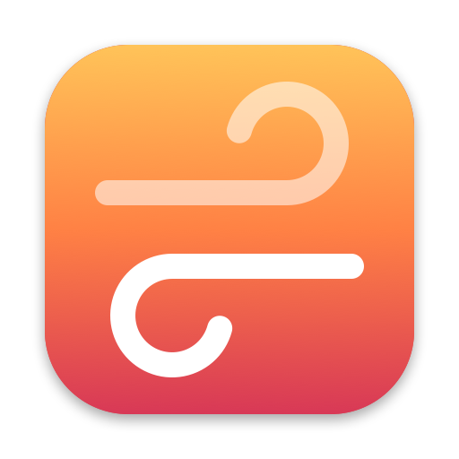
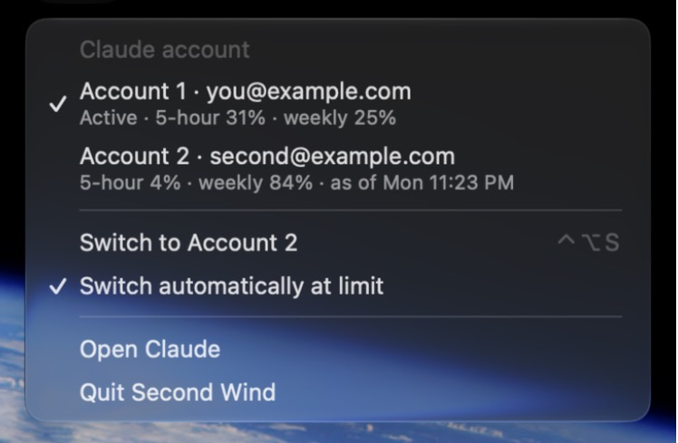

# Second Wind

Keep working in the Claude desktop app when one account hits its usage limit. Second Wind keeps two
Claude accounts signed in on one Mac, shows one shared list of Code sessions on both, and switches
between them from the menu bar or by itself.

## The problem

When the account you are using reaches its usage limit in the desktop app's Code tab, work stops
until the limit resets. If you have a second account, getting to it is slow and lossy:

- The app shows one account at a time. Switching means signing out and signing in again.
- Each account sees only its own Code sessions, so the session you were in is not there on the
  other account.

## The solution

Second Wind keeps both accounts signed in and makes them look like one workspace.

- **Both accounts stay signed in.** Each account runs as its own profile of the Claude app. Switching is quit one, open the other. No sign-in.
- **One session list.** Every Code session is copied into both accounts' lists. The conversations are shared, not duplicated.
- **Automatic switch at a limit.** When a session stops on a usage limit, Claude reopens on the other account with that session open. You type "continue".
- **Always visible.** A menu bar icon shows the active account and each account's last known usage.
- **Removable.** One script takes it out. Your sessions stay where they are.

The menu (the addresses are placeholders):



## How it works

1. **Two profiles.** Account 1 is the app's normal data folder. Account 2 is a second data folder,
   opened with the app's `--user-data-dir` option. Only one runs at a time.
2. **Copied session records.** While Claude is closed, the small record file for each session is
   copied between the accounts' folders, newest wins. The conversations themselves already live in
   `~/.claude`, which both profiles share.
3. **A hook spots the limit.** A Claude Code hook runs when a session stops on an API error. If it
   was a usage limit (not a passing 429), it leaves a note for the menu bar app.
4. **The menu bar app switches.** It quits Claude, syncs the sessions, and reopens Claude on the
   other account with a link to the same session.

It never touches credentials: no cookies, tokens or keychain. The reasoning behind each choice is
in the [decision records](docs/adr/README.md).

## Status

Installed on one Mac since 2026-11-09, with both accounts set up. 42 unit tests
cover the sync, the switch and the limit rules, and the switch has been run against the real app.

Not proven yet:

| Open question | Tracked in |
| --- | --- |
| Do the hooks fire in real desktop sessions? If not, the automatic switch never happens | [#1](https://github.com/space-cowboy2/second-wind/issues/1) |
| Does a session started on one account continue on the other? | [#3](https://github.com/space-cowboy2/second-wind/issues/3) |
| What happens at a real usage limit? None has occurred since install | [#7](https://github.com/space-cowboy2/second-wind/issues/7) |
| Is using a second account this way within Anthropic's terms? | [#4](https://github.com/space-cowboy2/second-wind/issues/4) |

The tool relies on undocumented behaviour of the Claude app, so an app update can break it. The
[specification](docs/spec.md) marks every claim as verified, read from the app's code, assumed or
open. The [plan](docs/plan.md) lists what is next.

## Requirements

- macOS 13 or later
- The Claude desktop app in `/Applications`
- Xcode with Swift 5.9 or later (to build)
- Two Claude accounts

## Install

```bash
scripts/install.sh
```

This builds the tool and installs:

| What | Where |
| --- | --- |
| Menu bar app (starts at login) | `~/Applications/Second Wind.app` |
| Command-line tool | `~/.local/bin/secondwind` |
| Two Claude Code hooks | `~/.claude/settings.json` (only the `hooks` section changes; a backup is written next to it) |

## Usage

### First use

1. Click the ⇄ icon, choose **Set up Account 2…**, then **Continue**.
2. Claude quits and reopens on a fresh profile. Sign in with the second account.
3. Your sessions are already there. If you signed in to an account this Mac has not seen before,
   Claude restarts once more to load them.

### Day to day

| You want | Do |
| --- | --- |
| Switch accounts | Menu → **Switch to Account N**, or ⌃⌥S |
| Stop automatic switching | Menu → untick **Switch automatically at limit** |
| See what it did | `~/Library/Application Support/AccountSwitcher/switch.log` |
| Switch from a terminal | `secondwind switch` |
| Check state | `secondwind status` |

After a switch you land on the same session: the one you had open, or after an automatic switch
the one that hit the limit. Type "continue".

## Limitations

**Shared between accounts:** the Code session list and every transcript, plus everything in
`~/.claude` (settings, memory, skills, plugins).

**Not shared:** connectors, scheduled tasks, Cowork sessions, sidebar sections and pins, Remote
Control links, usage and billing.

Things to know:

- Switching quits Claude. A session that is mid-turn stops; it stays in the list.
- Stars and pins do not follow you. A session you starred on one account is in the other
  account's list, but unstarred, under its date.
- Sessions sync while Claude is closed: at every switch, and whenever the menu bar app sees Claude
  quit. Never run both profiles at once; the app does not prevent it and the last writer wins.
- A "No folder" session opened on the other profile behaves like a normal folder session and may
  ask to trust its folder.
- Remote Control on your phone follows the account, so a switch drops the phone's connection.
- The second profile cannot pair with Claude in Chrome and downloads its own copy of Claude Code
  (about 300 MB) the first time.
- An app update restarts Claude on Account 1, whatever was open.
- Deleting a session on one account removes it from the other at the next sync. A copy of the
  record is kept in `AccountSwitcher/backups/deleted`. The transcript is left in `~/.claude`.

## Uninstall

```bash
scripts/uninstall.sh
```

Sessions stay in both profiles. The first sync saved every session folder as it was under
`~/Library/Application Support/AccountSwitcher/backups/initial-*` (each folder has an `ORIGIN.txt`
naming where it came from).

## Development

```bash
swift test
```

`SwitchCore` holds all logic (sync, switch engine, limit rules, hook installer, menu model) and is
tested without the real app. `secondwind --home DIR …` points the tool at a throwaway config for
experiments with throwaway profiles. Read [CONTRIBUTING.md](CONTRIBUTING.md) before changing
anything.

The app icon is drawn by `scripts/make-icon.swift`; run `scripts/make-icon.sh` after changing it.

## Documentation

| Document | What it covers |
| --- | --- |
| [docs/spec.md](docs/spec.md) | What the tool does, what is proven and what is not, requirements, architecture, data, risks |
| [docs/plan.md](docs/plan.md) | Milestones and the GitHub issues behind them |
| [docs/adr/](docs/adr/README.md) | Why it is built this way |
| [CONTRIBUTING.md](CONTRIBUTING.md) | Rules for changing it |
| [CHANGELOG.md](CHANGELOG.md) | What changed |

## License

[MIT](LICENSE).

Second Wind is an independent project. It is not affiliated with or endorsed by Anthropic, and it
relies on undocumented behaviour of the Claude desktop app. Whether using a second account this way
is within Anthropic's terms has not been established
([#4](https://github.com/space-cowboy2/second-wind/issues/4)); check before you rely on it.
